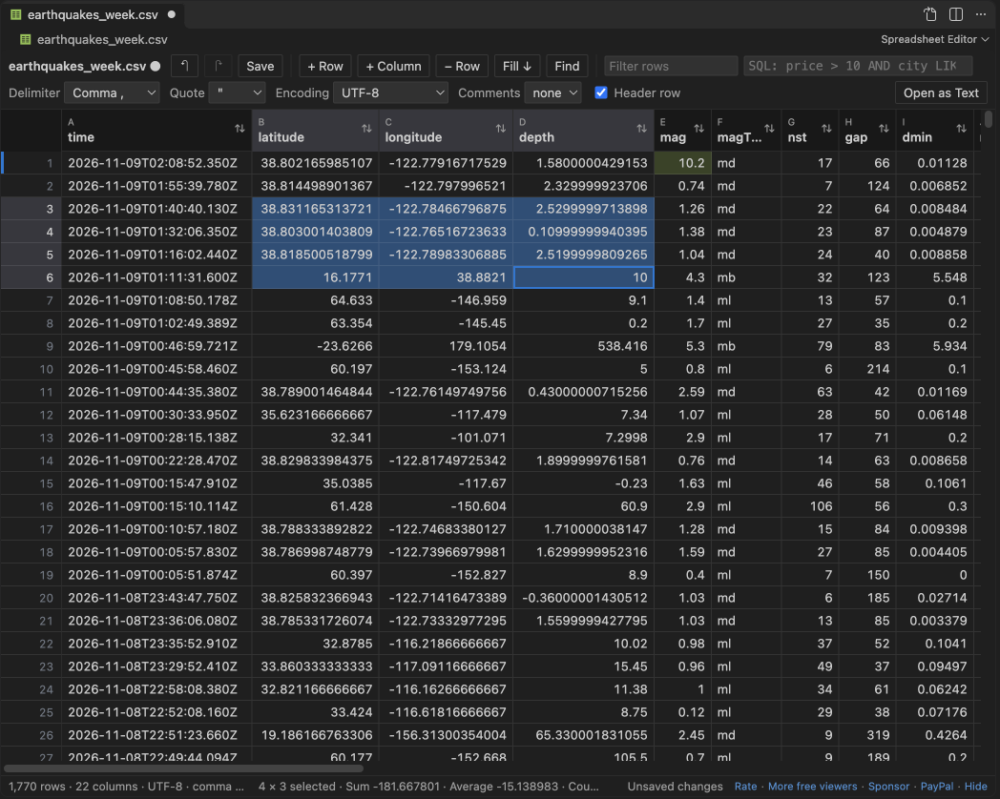
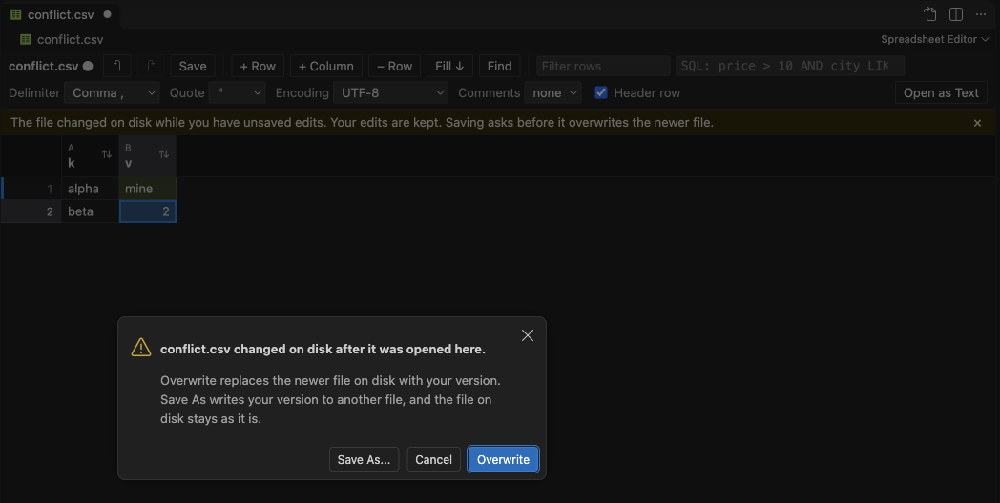
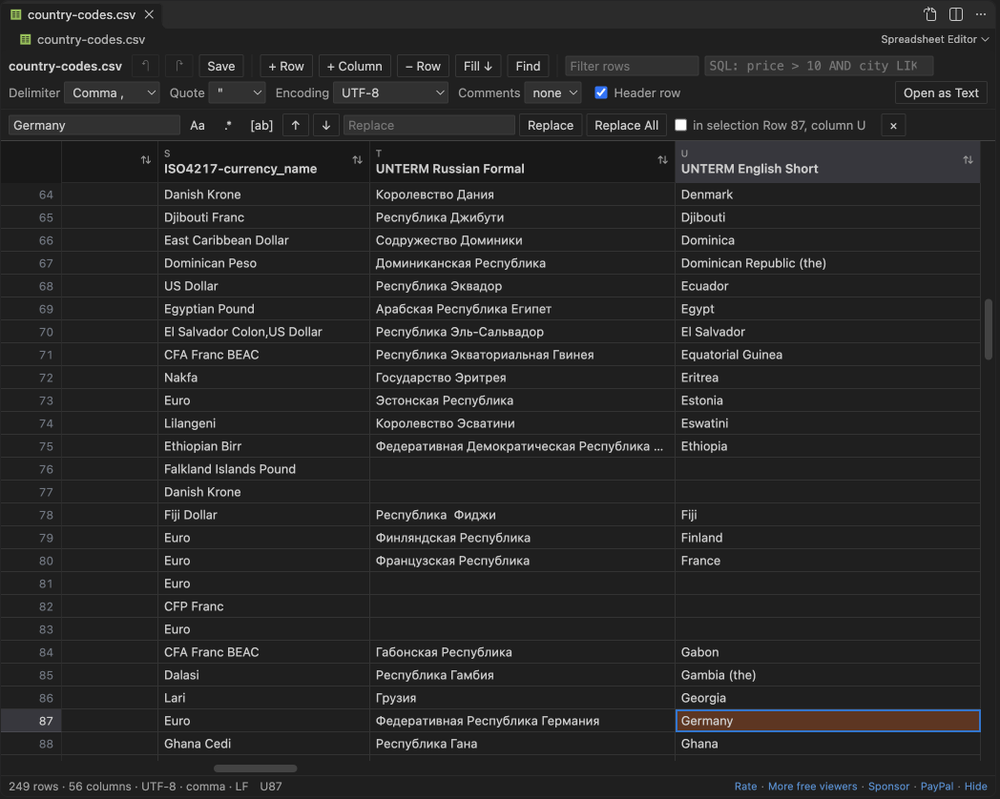
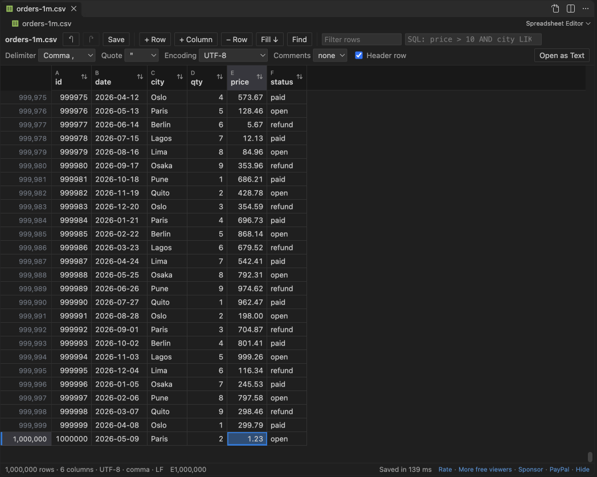
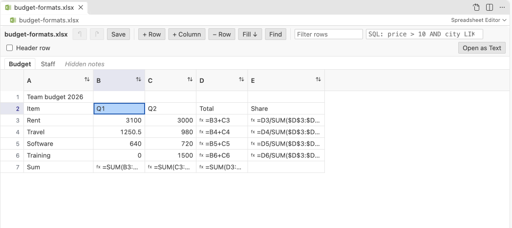

# Spreadsheet Editor for CSV, Excel & XLSX

Edit CSV, TSV and Excel files in VS Code as a spreadsheet, with real undo, real save and files of a million rows. Free, no sign-in, works offline.

- Type in a cell, press Enter, and the tab shows a dot until you save. Ctrl+Z, Ctrl+S, Revert and hot exit are VS Code's own.
- Rows you did not touch are saved byte for byte: delimiter, quotes, encoding, BOM and line endings stay as they were.
- 1,000,000-row CSV: opens in about 2 seconds and saves in about 1.3 seconds. A 200 MB file with 5.6 million rows opens in under 3 seconds.
- Excel .xlsx: change values and rows, and styles, number formats, merged cells, formulas and the other sheets stay.
- Find and replace with match case, regex and whole cell. Filter rows by text or with a SQL condition.
- Any delimiter (comma, semicolon, tab, pipe, or one you type), quote character, 13 encodings, comment lines.

## Why this one

People who edit CSV files in VS Code report the same problems again and again. This editor was built and tested against each of them. The numbers come from a real VS Code 1.142 run on real files (the test log is in the repository).

| What users report | What Spreadsheet Editor does | Measured |
|---|---|---|
| "I have lost data a few times now when I thought the data was saved" ([review, April 2025](https://marketplace.visualstudio.com/items?itemName=janisdd.vscode-edit-csv&ssr=false#review-details)); requests for a [data loss warning](https://github.com/janisdd/vscode-edit-csv/issues/196) and [a focused cell that is not saved by Ctrl+S](https://github.com/janisdd/vscode-edit-csv/issues/80) | Every edit goes into VS Code's own edit stack. The tab shows unsaved changes, Ctrl+S writes the file, closing asks first, and hot exit keeps unsaved edits across a restart. A file changed on disk while you edit is never overwritten without asking. | Edit, save, close and reopen: the change is there. Reload the window with unsaved edits: they come back. Change the file outside while editing: a note shows and Save asks "Overwrite" or "Save As". |
| "didn't work well with bigger CSV files" ([review, August 2023](https://marketplace.visualstudio.com/items?itemName=janisdd.vscode-edit-csv&ssr=false#review-details)); [files over 50 MB not supported](https://github.com/janisdd/vscode-edit-csv/issues/159), [opening files bigger than 50 MB](https://github.com/janisdd/vscode-edit-csv/issues/99) | The file stays as bytes with an index of where each row starts. Only the rows on screen are decoded. Saving copies untouched rows and writes edited ones. | 1,000,000 rows (38 MB): open 1.9 s, save 1.3 s, extension host 211 MB. 200 MB, 5.6 million rows: open 2.7 s, save 1.8 s, 585 MB. |
| "If you save the file, there is no history back" ([review, October 2023](https://marketplace.visualstudio.com/items?itemName=janisdd.vscode-edit-csv&ssr=false#review-details)); [moving columns breaks undo](https://github.com/janisdd/vscode-edit-csv/issues/71) | Undo and redo work before and after a save, for cells, rows, columns, moves, paste, fill down and Replace All (one step each). | 50 edits, 50 undos: the file is byte-identical to the original. 50 redos: all 50 cells come back. |
| "no custom separators, no custom comment prefix, ctrl+f barely usable" ([review, October 2025](https://marketplace.visualstudio.com/items?itemName=ReprEng.csv&ssr=false#review-details)) | Pick or type any one-character delimiter, a quote character and a comment prefix (#, // or ;). Ctrl+F (Cmd+F) opens find and replace with regex. | Semicolon, tab, pipe, UTF-16 and Windows-1252 files open with the right settings found on their own. |

## Edit

- Click a cell and type. Enter moves down, Tab moves right, Escape cancels. F2 or a double-click edits the text that is there. Alt+Enter adds a line break inside a cell.
- Right-click a cell, a row number or a column header to insert, delete or move rows and columns, rename a column, fill down, copy or clear. Alt+Up and Alt+Down move the selected rows. Alt+Left and Alt+Right move a column.
- Paste a block copied from Excel, Google Sheets or LibreOffice. It fills the cells from the selected one and adds rows and columns when it needs them. One value pasted on a selected range fills the whole range.
- Ctrl+D fills down: the first selected row is copied into the rows below it.
- Delete clears the selected cells. Ctrl+C copies them as tab-separated text for any spreadsheet.
- Edited cells are green and new rows have a + in the margin, so you can see what will be saved.
- The status bar shows the sum, average and count of the selected numbers.

## Find, filter and sort

- Ctrl+F (Cmd+F on a Mac) opens find and replace. Turn on match case, regular expressions or whole cell. Replace All works on the rows shown or on the selection only, and `$1` puts back a regex group.
- The Filter rows box shows the rows that contain some text. The SQL box takes a condition such as `price > 10 AND city LIKE 'Par%'`, with AND, OR, NOT, IN, BETWEEN, LIKE and IS NULL.
- Click the arrows in a header to sort. Sorting and filtering change the view only. The file keeps its order until you move rows yourself.
- Right-click a header and pick Column stats for count, empty cells, distinct values, sum, mean, min and max.

## What a CSV save keeps

- Every row you did not change, byte for byte. A test edits one cell in a 1,000,000-row file and checks that all other bytes are the same.
- The delimiter, the quote character, quoting of every field in files that quote everything, and the line ending of each row (mixed files stay mixed; new rows use the most common one).
- The encoding and the byte order mark: UTF-8, UTF-16 LE and BE, Windows-1252, 1250 and 1251, ISO-8859-15, KOI8-R, Shift_JIS, EUC-JP, GB18030, Big5 and EUC-KR. If you type a character that the encoding cannot hold, the save stops and offers a UTF-8 copy.
- Comment lines stay where they are, as they are.
- A save writes a temporary file next to yours and then renames it, so a failed save never leaves a half-written file.

## What an Excel save keeps

- Cell values you change are written with their type: numbers stay numbers, text that starts with = becomes a formula, and dates in date cells stay dates.
- Kept: styles, number formats, merged cells, column widths, formulas, hidden sheets and every other sheet. Excel calculates the formulas again when it opens the file.
- Not kept: pivot tables, charts, shapes, slicers and macros. Before the first save of a workbook that has them, a note lists them and offers Save a Copy, so the original stays as it was.
- Macro workbooks (.xlsm) are never written in place. Your edits go to a new .xlsx copy, and the .xlsm file is not changed.
- Workbooks up to 40 MB open for editing. Zip bombs and damaged files are refused before they are unpacked.

## Open files

- .xlsx and .xlsm files open in Spreadsheet Editor when you click them.
- For .csv, .tsv, .tab and .psv files, click the table icon in the editor title or right-click the file and pick Open in Spreadsheet Editor. To open them here every time, run "Spreadsheet Editor: Make Spreadsheet Editor the Default for CSV and TSV". Open as Text in the editor title switches back for one file.
- CSV files up to 512 MB open for editing and up to 1 GB read-only. Both limits are settings.

## Settings

| Setting | Default | What it does |
|---|---|---|
| `spreadsheetEditor.maxEditSizeMB` | 512 | CSV files up to this size open for editing. |
| `spreadsheetEditor.maxFileSizeMB` | 1024 | CSV files up to this size open read-only. |
| `spreadsheetEditor.maxExcelSizeMB` | 40 | Workbooks up to this size open for editing. |
| `spreadsheetEditor.maxExcelCells` | 5000000 | Cell limit for a workbook, all sheets together. |
| `spreadsheetEditor.maxCopyRows` | 200000 | Rows copied to the clipboard at once. |
| `spreadsheetEditor.autoReload` | true | Read the file again when it changes on disk and you have no unsaved edits. |
| `spreadsheetEditor.askForRating` | true | One rating question after a few good uses. Never after an error. |
| `spreadsheetEditor.showSupportLinks` | true | The small Rate, More free viewers and Sponsor links in the status bar. |

## Privacy

The extension makes no network calls. Files are read and written on your computer, and nothing about them is sent anywhere. There is no telemetry and no account. It needs VS Code 1.90 or later, so it also installs in Cursor, Windsurf and VSCodium.

## Free

Everything in this version is free, with no limit on rows, edits or saves, and no ads. A Zovo Pro license for larger files may come later. It will never lock opening, viewing, editing or saving a file.

## Support Zovo

Zovo extensions are free, with no ads and no tracking. They are made by [theluckystrike](https://github.com/theluckystrike) on GitHub. If this one saves you time, you can support the work:

- [Sponsor on GitHub](https://github.com/sponsors/theluckystrike)
- [PayPal](https://www.paypal.com/paypalme/najzzz)
- [Follow theluckystrike on GitHub](https://github.com/theluckystrike)

## More tools by Zovo

- [PDF Viewer & Reader to Read and View PDF in Dark Mode](https://marketplace.visualstudio.com/items?itemName=zovo.pdf-viewer-dark) reads PDFs with a real dark mode, search, an outline and thumbnails.
- [XLSX Viewer & CSV Preview for Excel, XLS & Parquet](https://marketplace.visualstudio.com/items?itemName=zovo.table-viewer-vscode) opens CSV, TSV, Excel and Parquet files as a sortable, filterable table.
- [DOCX Viewer & ODT Viewer, Word Document Preview (Dark Mode)](https://marketplace.visualstudio.com/items?itemName=zovo.docx-viewer-vscode) previews Word and ODT files with dark mode, an outline and search.

See [all Zovo extensions on the Marketplace](https://marketplace.visualstudio.com/publishers/zovo).

## License

MIT. Third-party licenses are in THIRD-PARTY-NOTICES.txt.
